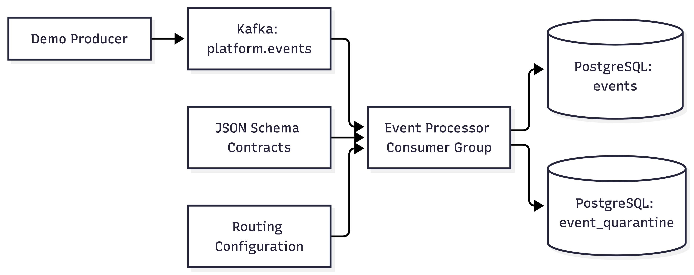

# Event Processor Design

## Problem Statement

Application produce events from different contexts such as transactions, monitoring, user-management,there could be more producers. These events need to validated, prepared for downstream delivery.

Event processsor pipeline consume events from producers in kafka, validates the message paylaod, envelope, verify authorized destination and store the results in PostgreSQL DB.
Each event includes producer, tenant, receiver, event type, and a schema version.

Events that pass validation and have authorized destination are maked READY and routed, invalid events are maked with validation errors as INVALID.
Conflicting events and encoding failures are preserved in quarantine.

Unique constraints in db prevents duplicate events rows during replay. Kafka messages are ackd only after successful persistence.

Processor pipeline does not focus on the actual delivery to clients.

## Architecture Overview

| Component |  Responsibility |
| --- | --- |
| `cmd/producer` | Generates sample valid and invalid events and publishes them to kafka
| `cmd/processor`| Load config, initialize dependencies, create kafka reader, handler shutdown signals
| `consumer`|                        Fetches message, call processor, retries transient failure, commits offset
| `processor`|                        Coordinate validation, routing and persistence
| `validation`|                      Check the envelope and validate payload against the contract by event type and schmea version
| `routing`|                    Resolves a destination from tenantID, event type, receiver ID
| `repository`|                      Stores recrods, handles duplicates, conflicts,etc.
| `model`|                           Defines shared envelopes, records, kafka metadata, error types.
| `schemas`|                         JSON Schema contracts
| `config`|                          Routing rules.
| `migrations`|  Defines PostgreSQL tables, unique constraints for dedup and indexes for querying events.

## Key Design Decisions

### Kafka for event-driven ingestion

Kafka supports event retention, replays after failures. Consumer group and paritions provide scalability for future sacling across multiple instances.

### JSON Schema for validation

JSON Schema provides delvative payload validation and keep events easy to generate, inspect and debug.
Contracts are selected by event type and schema version and loaded at startup.

Protobuf offers compact binary serialization and generated types on the contracts, but requires additional code generatio

### Config Based Routing

Routing Rules match tenatID, event type and receiver ID. An event is marked READY when validation is success and an authorized destination exists.

A missing route gets INVALID record tag.

Similar to schema routing config is loaded at startup.

### PostgreSQL for persistence

Postgres provides tranasctions, indexes and unique constanints.latency, idemptency through queries, indexes and unique constaints.

- At least once processing with idempotent persistence
- Explicit duplicate and conflict handing
- Preseve invalid and problamtic events
- Retry temporary failures and recover through replay

## Failure Modes

- Malformed/Invalid Events : Invalid json, missing field, unsupported schema version and schema violation produce an INVALID record. 
- Missing Routing Configuration for an event: If no route matcehs the tenant, event type, receiver, the event is INVALID, and market not ready for delivery.
- PostgreSQL Outage: Failed persistence to DB are retried with exponential backoff, Kafka offset is uncommmited until pesistence is successful.
- Duplicate Delivery: Unqiue constraints on kafka topic/partition/offset, tenant and event IDs prevent duplicat rows. Reprocess does not insert another row.
- Conflicting events: same tenant/event ID with different bytes is quarantined.
- Shutdown: in flight processing in cancelled, unack message replay after restart.
- Crash before db commit : offset is uncommited, event can replay after restart.
- Crash after db commit but before kafka ack : the stored event remains avaialble. Replay is handled through idempotent persistnce.
- Invalid schema: Startup fails with an error with invalid config
- Duplicate event: Unique constraints and duplicate checks prevent another row.

## Known Limitations
- Demo uses 1 kafka broker and 1 db instnace so it does not provide high availability or database failover.
- Removing docker volumes or `make clean` can delete the persisted data.
- Single Consumer group, no partion-key stragey on producers, it uses a `tenant-demo` fixed key.
- Each consumer proceess one message at a time, processing does not use db batching. 
- Envelope validation rejects unknow fields, so adding envelope fields requires a processor update.
- Routing is satic, loaded on starup.
- No kafka dead-letter topic, hence quarantined messages are stored in db, and there is no automated replay workflow.
- Schema compilcation is per-file and loaded at startup.
- No Delivery Service ( out of scope )

